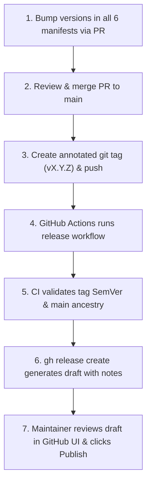

# Versioned Releases (`docs/releases.md`)

`indonesian-linguist` follows the **Elephant-Goldfish Model (EGM)** release paradigm. Release creation is automated via GitHub Actions, but releases are staged as **Draft Releases** for maintainer review before publication.

---

## 1. Canonical Version & Manifest Synchronization

The canonical version of `indonesian-linguist` is defined in `package.json` (`"version"`).
Whenever a version bump occurs, the version string must be updated identically across all **six versioned manifests**:

1. `package.json`
2. `plugin.json`
3. `gemini-extension.json`
4. `.claude-plugin/plugin.json`
5. `.codex-plugin/plugin.json`
6. `.github/plugin/plugin.json`

Our automated test suite (`tests/manifests.test.js`) validates that all manifests declare the identical SemVer version on every commit.

---

## 2. Release Candidate Lifecycle



### Step 1: Version Bump PR
1. Create a branch `chore/bump-vX.Y.Z`.
2. Update the version string in all six manifests.
3. Run all quality checks locally per [`docs/testing.md`](testing.md) (`npm test`, `node scripts/audit-id.js docs/*.md scripts/README.md references/README.md references/domains/README.md`, and `npx markdownlint-cli2`).
4. Open a pull request titled `chore(release): bump version to X.Y.Z`.
5. Review and merge the pull request into `main`.

### Step 2: Create & Push Git Tag
Once the PR is merged to `main`, checkout the latest `main` locally and push an annotated git tag:

```bash
git checkout main
git pull origin main

# Tag format must strictly be vMAJOR.MINOR.PATCH (or vMAJOR.MINOR.PATCH-prerelease)
git tag -a v1.0.0 -m "Release v1.0.0"

# Push the tag to GitHub
git push origin v1.0.0
```

### Step 3: Automated Workflow Execution (`.github/workflows/release.yml`)
When a `v*` tag is pushed:
1. **Concurrency Lock**: Scoped to `release-${{ github.ref }}` so distinct tags do not cancel each other.
2. **Test Gate**: Reuses `.github/workflows/test.yml` to run the complete test suite.
3. **Safety Guardrails**:
   - Validates that the tag matches strict SemVer 2.0.0 without leading zeroes.
   - Verifies the tagged commit is an ancestor of `origin/main` (`git merge-base --is-ancestor HEAD origin/main`).
   - Verifies the tag matches `package.json`'s version.
4. **Draft Release Generation**:
   - Calls `gh release create "$GITHUB_REF_NAME" --title "$GITHUB_REF_NAME" --generate-notes --draft --verify-tag`.
   - Automatically detects prerelease tags (`^v[0-9]+\.[0-9]+\.[0-9]+-`) and appends `--prerelease`.
   - GitHub auto-generates the release notes listing all merged PRs, authors, and commit comparisons since the last tag.

### Step 4: Review Draft & Publish
1. Navigate to the repository's [Releases page](https://github.com/m-ridha/indonesian-linguist/releases).
2. The newly created release will be marked as a **Draft** (only visible to repository maintainers).
3. Review the release notes, optionally add highlights or migration notes, and click **"Publish release"**.

---

## 3. Troubleshooting & Safety Guardrails

- **"Tag does not match package.json version"**: Ensure `package.json` was bumped and merged before pushing the tag.
- **"Tagged commit is not on main"**: The release workflow prevents releasing unmerged experimental branches. Always ensure the tag points to a commit on `origin/main`.
- **Duplicate Releases**: The workflow does not overwrite existing published releases. If a release attempt fails, fix the underlying issue before retrying.
